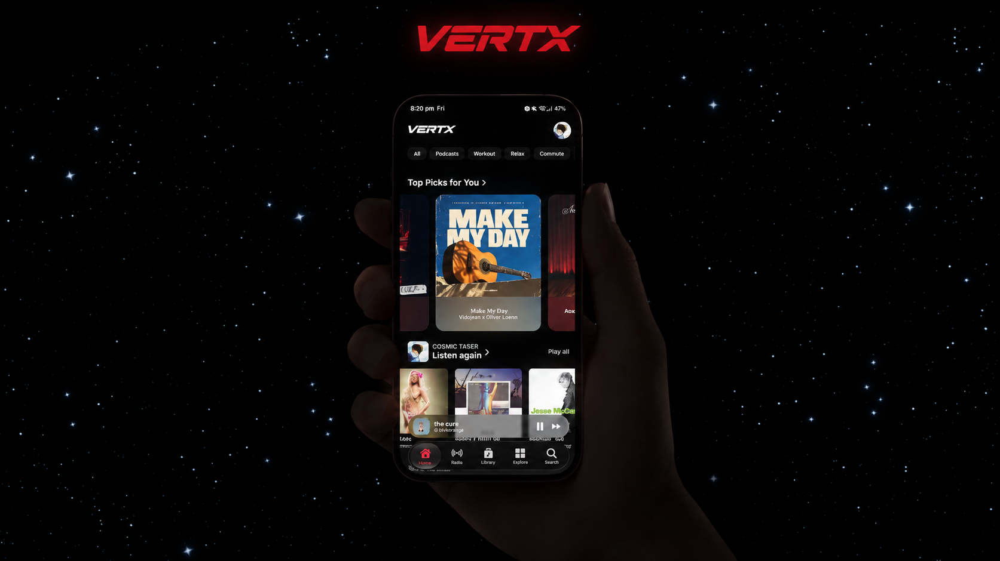

<div align="center">
  
  <h1>Vertx</h1>
  <p><strong>An open-source Android music player with a calm, glass-inspired interface.</strong></p>
  <p>
    <a href="https://github.com/primearijit/Vertx-2.0/releases/latest">
      
    </a>
  </p>
  <p>
    <a href="https://github.com/primearijit/Vertx-2.0/releases">
      
    </a>
  </p>
  <p>
    <a href=".github/CONTRIBUTING.md">Contributing</a> ·
    <a href="https://discord.gg/Ejeb4cmzfd">Community</a>
  </p>
  <p>
    
    
  </p>
</div>

Vertx brings music discovery, playback, lyrics, and your library together in one Android app. It is built with Kotlin, Jetpack Compose, and Media3, with custom Cupertino-style controls and Liquid Glass surfaces.

## Features

### Playback

- Browse and stream music through Convx's InnerTube client.
- Keep listening in the background with notification, lock-screen, and Android Auto controls.
- Save music for offline listening and manage a local library.
- Build queues and playlists, set a sleep timer, change playback speed, and use the equalizer.
- Use crossfade, Automix, and DJ-style transitions.

### Lyrics and artwork

- Follow synchronized lyrics with word-level highlighting.
- Explore animated artwork and album-inspired colors.
- Browse lyrics from multiple providers.

### Library and integrations

- Browse local music and network shares, including SMB and WebDAV.
- Import playlists from Spotify.
- Connect Discord Rich Presence, Last.fm, music recognition, and Listen Together.

### Vertx interface

- Frosted, refractive glass surfaces for menus, sheets, and floating controls.
- Cupertino-style controls built for Convx's HIG and Android interaction patterns.
- Adaptive themes and layouts for phones and wider screens.

## Download

- **Stable:** [Download the latest release](https://github.com/primearijit/Vertx-2.0/releases/latest).

Vertx supports Android 8.0 (API 26) and later. Install APKs only from sources you trust. Android may ask you to allow installation from the app you used to download the APK.

<hr>

<div align="center">
  <a href="https://github.com/cosmictaserdev-creator/Convx">
    
  </a>
  <p><i>Special thanks to <a href="https://github.com/cosmictaserdev-creator/Convx">Convx</a> for architectural components and inspiration!</i></p>
</div>

<div align="center">

  <h2>🙏 Credits</h2>

  <p>Vertx is forked from Convx which is developed and maintained by <a href="https://github.com/cosmictaserdev-creator/Convx">Aryan (cosmictaser)</a>. See <a href="https://github.com/cosmictaserdev-creator">Github</a> for the portfolio.</p>

  <table border="0" cellpadding="10" cellspacing="0" width="90%">
    <tr valign="top">
      <td width="40%" align="left">
        <b>💡 Built On</b>
        <ul>
          <li><strong><a href="https://github.com/vivizzz007/vivi-music">vivi-music</a></strong> by <strong>Vividh P Ashokan</strong> — the project Convx was forked from.</li>
          <li>The <strong>Apple Music Player V17</strong> full-screen player style (Settings → Player Theme) is ported from <a href="https://github.com/vivizzz007/vivi-music">vivi-music</a>'s Apple Music player UI, GPL-3.0.</li>
        </ul>
      </td>
      <td width="60%" align="left">
        <b>🎖️ Foundational Projects</b>
        <ul>
          <li><strong><a href="https://github.com/Kyant0/backdrop">Kyant0/backdrop</a></strong> — the real-time backdrop blur/refraction library the Liquid Glass UI is built on.</li>
          <li><strong><a href="https://github.com/better-lyrics/better-lyrics">Better Lyrics</a></strong> and <strong><a href="https://github.com/maxrave-dev/SimpMusic">SimpMusic</a></strong> — synced lyrics.</li>
          <li><strong><a href="https://github.com/ibratabian17/YouLyPlus">YouLyPlus</a></strong> — in-app lyrics styling.</li>
          <li><strong><a href="https://github.com/monochrome-music/monochrome">Monochrome</a></strong> — the animated visualizer canvas.</li>
        </ul>
      </td>
    </tr>
  </table>

## Project structure

Vetrx is a Gradle multi-module Android project. Keep code in the module that owns the capability, and use its existing public APIs when another module needs it.

| Path | Responsibility |
| --- | --- |
| `app/` | Android application, screens, ViewModels, navigation, playback service, persistence, and app wiring. |
| `hig/` | Shared Cupertino-style controls, theme primitives, accessibility helpers, and glass utilities. |
| `innertube/` | InnerTube client and related models. |
| `lyrics/` | Lyrics providers, parsing, and lyrics support. |
| `canvas/` | Animated canvas and catalog features. |
| `artwork/` | Artwork loading, caching, and transitions. |
| `spotify/` | Spotify authentication and playlist import. |
| `integrations/` | Discord, Last.fm, music recognition, and related integrations. |
| `network-storage/` | SMB and WebDAV music sources. |
| `spine/` | Add-on module hosting and lifecycle. |
| `listen-together-server/` | Server component for Listen Together. |

The Android app uses Jetpack Compose for UI, Media3 for playback, Room for the local library, and DataStore for preferences. App modules are wired through the existing Hilt setup.

## Build locally

### Requirements

- JDK 21
- Android Studio with Android SDK 37 installed
- Android NDK for native components

Clone the repository, open it in Android Studio, and let Gradle sync. To build a debug APK or run unit tests from a terminal:

```bash
./gradlew :app:assembleUniversalFossDebug
./gradlew :app:testUniversalFossDebugUnitTest
```

On Windows, use `gradlew.bat` with the same task names. The `Foss` build omits Google Play services; the `Gms` build includes Google Cast support.

## Contributing

Bug reports, fixes, and feature contributions are welcome. Start with the [Contributing Guide](.github/CONTRIBUTING.md), follow the [Code of Conduct](CODE_OF_CONDUCT.md), and read the [Security Policy](SECURITY.md) before reporting a vulnerability.

AI agents should also follow the [Agent Contribution Guide](AGENT_CONTRIBUTION_GUIDE.md). Its Android, animation, code review, and requirement discovery skills are bundled under [`contributor/skills/`](contributor/skills/) and work offline.

## Support

- [Discord community](https://discord.gg/Ejeb4cmzfd)
- [Support Convx on Ko-fi](https://ko-fi.com/cosmictaser)
- [Project website](https://cosmictaser.de5.net)

## Legal

Vertx is an independent project and is not affiliated with, endorsed by, or connected to YouTube, Google, or their affiliates. Some features use unofficial third-party interfaces that may change or stop working. Users are responsible for following applicable laws and service terms.

Vertx is licensed under the GNU General Public License v3.0. See [LICENSE](LICENSE) and [NOTICE](NOTICE) for license and third-party attribution details.

---

Maintained by [Arijit](https://instagram.com/primearijit).
